# InvenTrack: End-to-End DevOps Project

**Name:** Abhi Gandhi
**Roll Number:** 10397
**Session 21:** Final DevOps Project and Troubleshooting
**Repository:** https://github.com/AbhiGandhi02/inventrack-devops (public)

InvenTrack is a stock-control app for a small office-supplies shop. Staff add items, receive and ship stock (every change goes into a movement history), search by name, SKU or supplier, and see at a glance what needs reordering. Around the app is the full course toolchain: Git, CI/CD, DevSecOps, Docker, Kubernetes, Helm, Terraform, monitoring and GitOps. Every screenshot in this repository comes from commands and pipelines that actually ran.

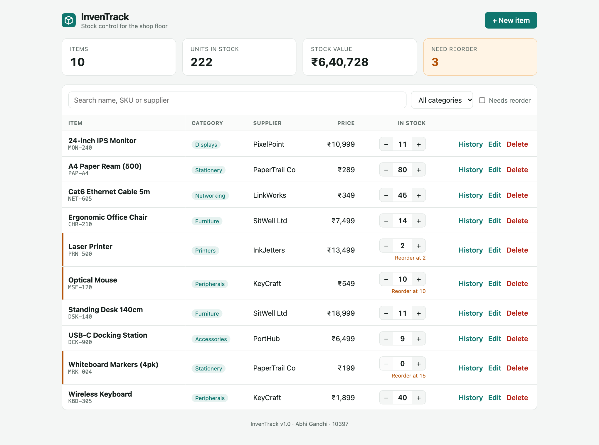

---

## 1. Architecture

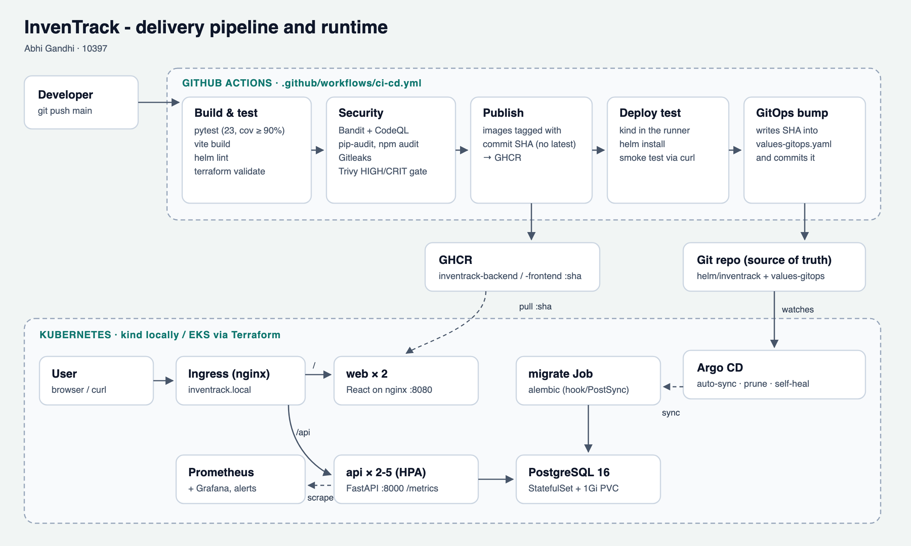

```
git push ─► GitHub Actions: test · SAST/SCA/secrets · build · Trivy gate · push :sha to GHCR · deploy test on kind
                                                                                  │
                     Git (values-gitops.yaml) ◄── CI commits the new SHA ◄────────┘
                               │
                           Argo CD ─► Kubernetes (kind locally / EKS from Terraform) ─► Ingress ─► web + api ─► PostgreSQL
                                                     │
                                                     └─► Prometheus + Grafana + alert rules
```

## 2. Technologies

| Area | Tools |
|---|---|
| Backend | Python 3.12, FastAPI, SQLAlchemy 2.1, Alembic, Pydantic v2 |
| Frontend | React 19, Vite 8, served by unprivileged nginx |
| Database | PostgreSQL 16 |
| Testing | pytest, pytest-cov, FastAPI TestClient on SQLite |
| Containers | Docker (multi-stage, non-root), Docker Compose |
| CI/CD | GitHub Actions, GitHub Container Registry |
| Security | Bandit, CodeQL, pip-audit, npm audit, Gitleaks, Trivy |
| Orchestration | Kubernetes (kind), Helm 4, ingress-nginx, HPA, metrics-server, Pod Security `restricted` |
| Infrastructure | Terraform: AWS VPC + EKS, LocalStack + kind for a no-cost apply |
| Monitoring | kube-prometheus-stack (Prometheus, Alertmanager, Grafana) |
| GitOps | Argo CD |

## 3. Repository layout

```
inventrack-devops/
├── .github/workflows/ci-cd.yml   # 15-job pipeline
├── application/
│   ├── backend/                  # FastAPI app, Alembic migrations, 23 pytest tests, Dockerfile
│   └── frontend/                 # React app, nginx template, multi-stage Dockerfile
├── docker-compose.yml            # `docker compose up --build` from the root (includes docker/)
├── docker/                       # Compose stack + notes
├── k8s/ , kubernetes/            # namespace.yaml (restricted PSS), kind cluster config, notes
├── helm/inventrack/              # chart: api, web, postgres, ingress, HPA, PDB, migration Job, ServiceMonitor
├── terraform/                    # AWS VPC + EKS, shared network module, LocalStack/kind root in local/
├── monitoring/                   # Prometheus/Grafana values, dashboard, alert rules
├── gitops/                       # Argo CD Application
├── security/                     # DevSecOps write-up + local Trivy gate script
├── troubleshooting/              # 4 break-and-fix scenarios
├── scripts/                      # seed.sh, load-test.sh
├── screenshots/
└── architecture.svg / .png
```

| Rubric path | Here |
|---|---|
| `backend/app/`, `backend/alembic/versions/`, `backend/requirements.txt` | `application/backend/…` |
| `backend/tests/`, `pytest.ini`, `conftest.py` | `application/backend/tests/`, `application/backend/pytest.ini`, `application/backend/tests/conftest.py` |
| `backend/Dockerfile`, `frontend/Dockerfile` | `application/backend/Dockerfile`, `application/frontend/Dockerfile` |
| `docker-compose.yml` | root `docker-compose.yml` (includes `docker/docker-compose.yml`) |
| `k8s/namespace.yaml` | `k8s/namespace.yaml` (same as `kubernetes/namespace.yaml`) |
| `helm/`, `terraform/`, `monitoring/`, `.github/workflows/` | same paths |

---

## 4. Application (M1)

### API

| Method | Path | What it does |
|---|---|---|
| GET | `/health` | Liveness: the process is up (no DB call) |
| GET | `/ready` | Readiness: runs `SELECT 1`, returns 503 if the DB is unreachable |
| GET | `/metrics` | Prometheus metrics |
| GET | `/api/items` | List items. `search` (name/SKU/supplier), `category`, `reorder_only` |
| POST | `/api/items` | Create (422 on invalid input, 409 on duplicate SKU) |
| GET | `/api/items/{id}` | Read one (404 if missing) |
| PUT | `/api/items/{id}` | Partial update. Only the fields sent change (409 on SKU clash) |
| DELETE | `/api/items/{id}` | Delete (also deletes its movements) |
| POST | `/api/items/{id}/movements` | Receive (+) or ship (−) stock with a reason. Can't go below 0 |
| GET | `/api/items/{id}/movements` | Movement history, newest first |
| GET | `/api/summary` | Item count, units, stock value, items needing reorder, categories |
| GET | `/api/categories` | Distinct categories (fills the filter dropdown) |

Interactive docs are at `/docs`:

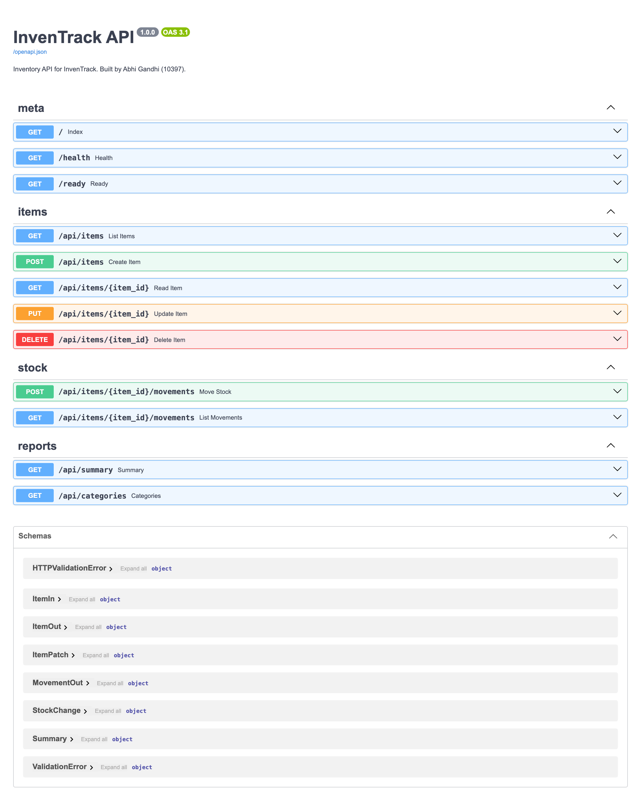

### Database

Two tables, created by two Alembic migrations in `application/backend/alembic/versions/`:

- `items` has a unique SKU index and a `CHECK (quantity >= 0)` constraint
- `stock_movements` has an FK to `items` with `ON DELETE CASCADE` and records `change`, `reason` and `quantity_after`

Docker Compose runs `alembic upgrade head` before the API starts. In Kubernetes a Helm hook Job runs it once per release, so replicas never race each other.

### UI

Summary cards, debounced search, category and "needs reorder" filters, +/− stock buttons (each one records a movement), add/edit form with server-side validation errors, and a per-item stock history. Items below their reorder level get an amber marker. On phones the cards go 2×2 and table rows become cards.

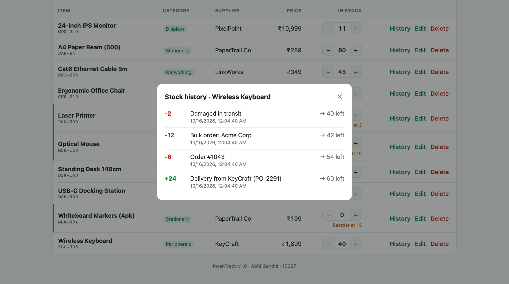

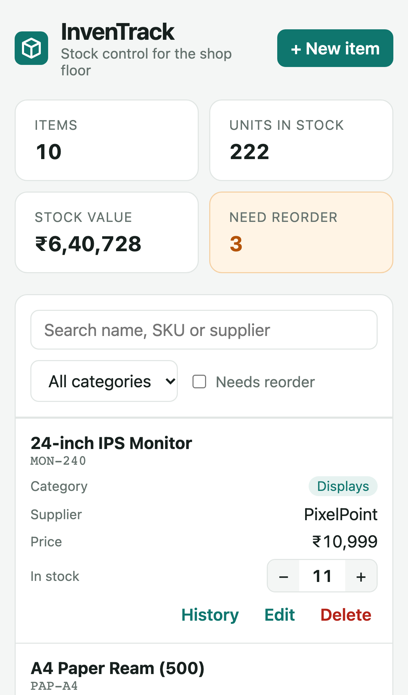

## 5. Testing (M2)

```bash
cd application/backend
python3.12 -m venv .venv && source .venv/bin/activate
pip install -r requirements-dev.txt
pytest -v --cov=app --cov-report=term-missing
```

There are **23 tests** in three files, covering every endpoint and the error paths: 404, 409 on create and update, 422 with the failing fields checked, shipping more than is in stock, zero-change movements, filters, movement ordering, summary maths and the metrics format. `tests/conftest.py` points the app at a throwaway **SQLite** file before the app is imported, creates the tables for each test and deletes the file afterwards, so PostgreSQL is never touched. CI also fails if coverage drops below 90%.

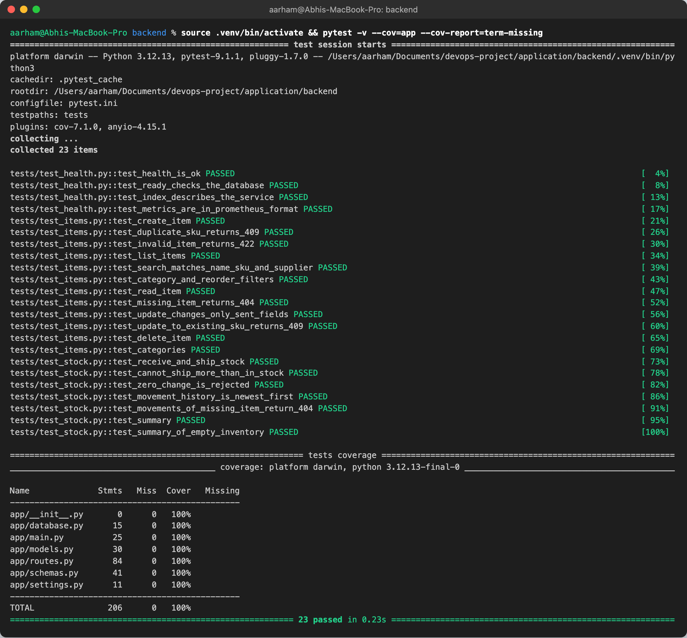

## 6. Git and GitHub (M3)

- Public repo: https://github.com/AbhiGandhi02/inventrack-devops
- Commits are small and each has one purpose: backend, frontend, Docker, Helm, Terraform, CI, docs, plus commits written by the GitOps bot.
- `.gitignore` covers `.env`, `__pycache__/`, `.venv/`, `node_modules/`, `dist/`, Terraform state and `.terraform/`, `terraform.tfvars`, kubeconfigs and local secret backups.

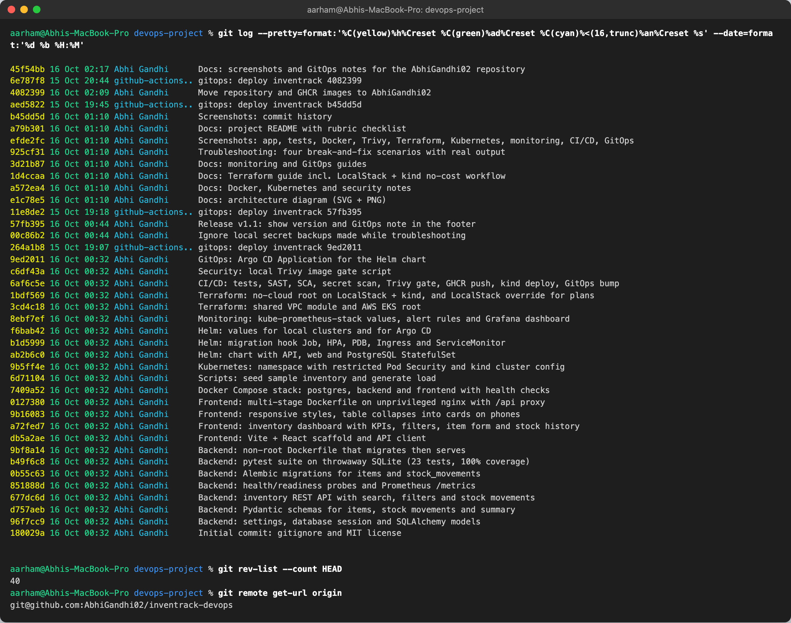

## 7. Docker (M4)

```bash
docker compose up --build -d          # FRONTEND_PORT=3001 if 3000 is taken
./scripts/seed.sh http://localhost:8000
open http://localhost:3000
```

| Image | How it's built | User |
|---|---|---|
| backend | `python:3.12-slim`, dependency layer cached separately, `HEALTHCHECK` | `inventrack` uid **10001** |
| frontend | stage 1 `node:22-alpine` → `npm ci && vite build`; stage 2 `nginx-unprivileged:1.29-alpine` + `apk upgrade` | `nginx` uid **101** |

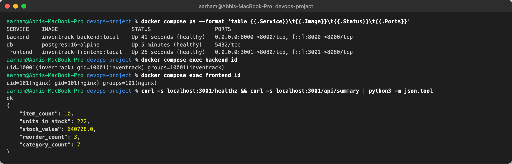

More in [docker/README.md](docker/README.md).

## 8. CI/CD (M5)

[`.github/workflows/ci-cd.yml`](.github/workflows/ci-cd.yml) runs on every push and PR to `main`:

| Stage | Jobs |
|---|---|
| Build & test | `backend-tests` (pytest, fails the build), `frontend-build`, `iac-lint` (helm lint + terraform fmt/validate) |
| Security | `sast` (Bandit + CodeQL), `sca` (pip-audit + npm audit), `secrets` (Gitleaks) |
| Images | `build-images` (matrix, tagged `${{ github.sha }}`, saved as an artifact) → `scan-images` (Trivy on the same tarball) |
| Gate | `security-gate` needs every check above |
| Delivery | `publish` → `ghcr.io/abhigandhi02/inventrack-devops/inventrack-{backend,frontend}:<sha>` |
| Deploy test | `deploy-test`: kind cluster in the runner, `helm upgrade --install`, smoke test (healthz, summary, create + read an item) |
| GitOps | `gitops-bump`: commits the SHA to `helm/inventrack/values-gitops.yaml` |

Images are **never tagged `latest`**. Every image maps to one commit. (On the GHCR page, "Latest" is GitHub's badge for the newest version, not a tag.)

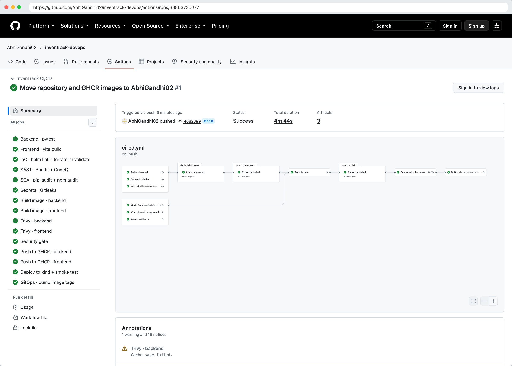

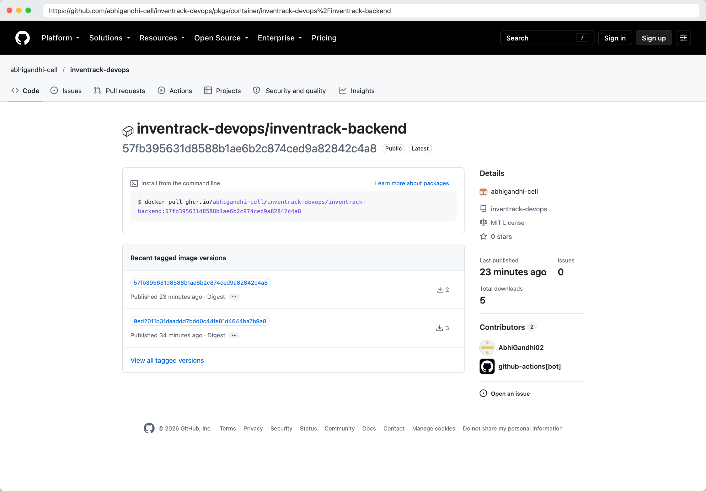

## 9. DevSecOps (M6)

Trivy scans **both** images in CI with `severity: HIGH,CRITICAL`, `ignore-unfixed: true` and `exit-code: 1`, so any fixable HIGH or CRITICAL CVE stops the pipeline before anything is pushed.

**What Trivy found:** a frontend build *without* `apk upgrade` had **43 HIGH** CVEs in Alpine 3.23.4 packages. For example **CVE-2026-33630**, a use-after-free/double-free in **c-ares** (1.34.6-r0, fixed in 1.34.8-r0), and several **curl** issues such as CVE-2026-12064 (SSH host verification bypass). They came from the base image, not from my code. Adding `apk upgrade --no-cache` to the runtime stage brought it to **0**. The backend image was clean from the start. Full write-up: [security/README.md](security/README.md).

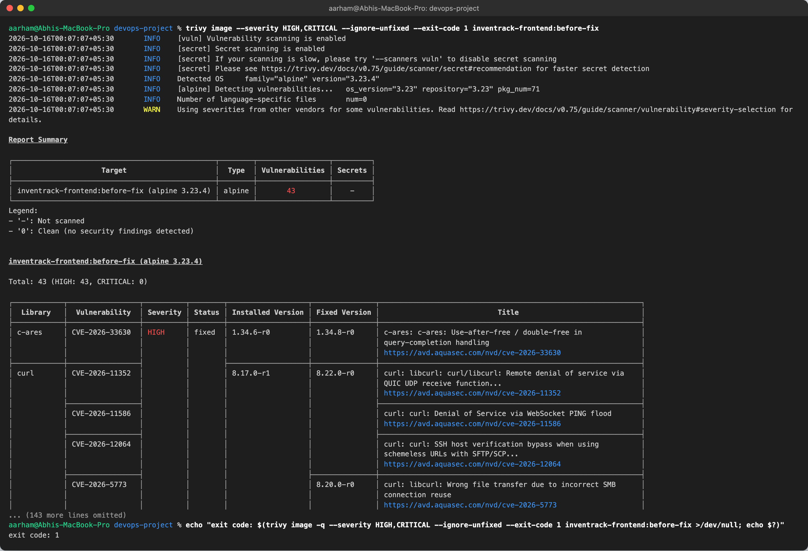
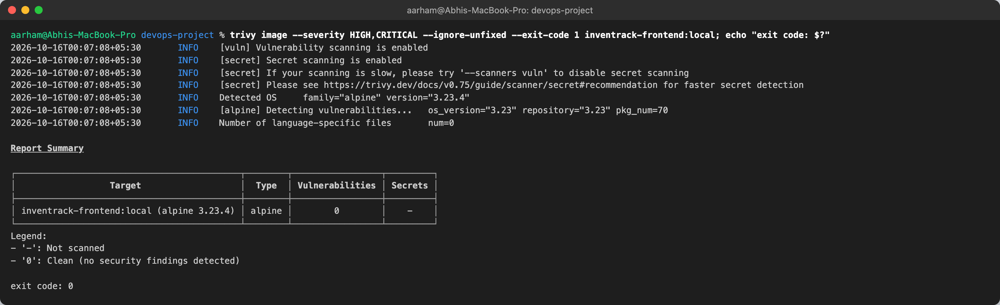
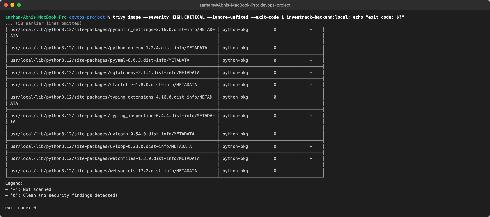

## 10. Terraform (M7)

`terraform/` defines the AWS target: a VPC (`10.40.0.0/16`, **2 public + 2 private subnets** in 2 AZs, IGW, NAT) through a reusable `modules/network`, and an **EKS** cluster (1.34) with a managed node group (`t3.medium`, 2–4 nodes) in the private subnets. Credentials only come from `aws configure`, and only `terraform.tfvars.example` is committed.

**No paid AWS account was used.** Instead:

1. `fmt`, `init` and `validate` pass for both roots, both locally and in CI.
2. With a LocalStack override, `terraform plan` of the **unchanged AWS VPC + EKS root** plans **57 resources**, including the EKS cluster and node group.
3. `terraform/local/` applies the **same network module** to LocalStack's emulated EC2 API, plus a kind cluster where EKS would be: real `plan → apply (20 added) → inspect → destroy (20 destroyed)`.

Details and the limits of this approach are in [terraform/README.md](terraform/README.md).

```bash
cd terraform && terraform init && terraform validate              # AWS root
docker run -d -p 4566:4566 localstack/localstack:4.14
cd local && terraform init && terraform plan -out=tfplan && terraform apply tfplan && terraform destroy
```

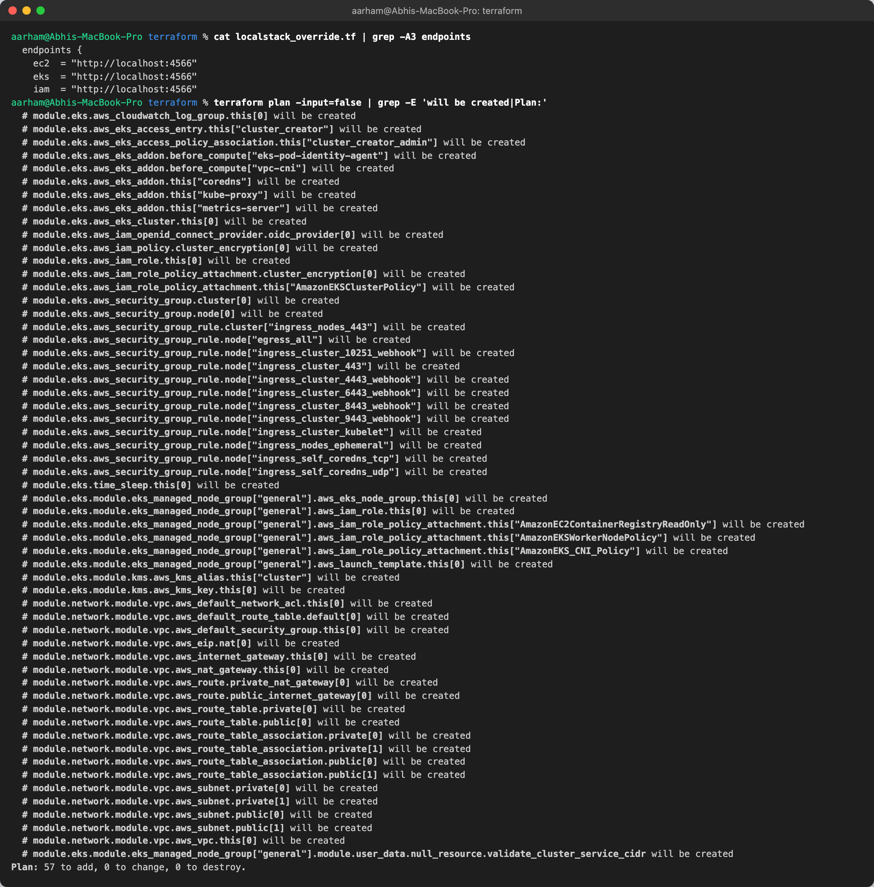
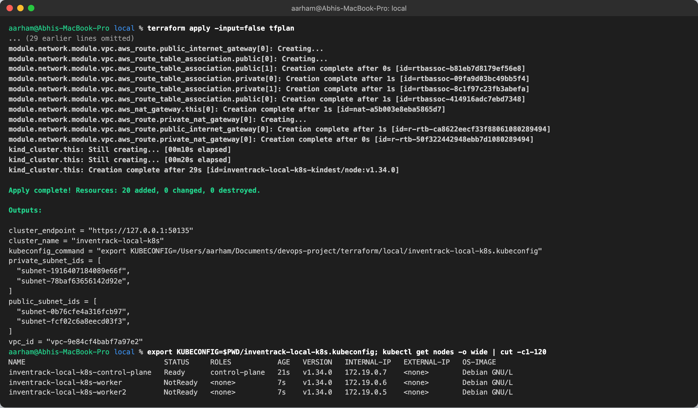
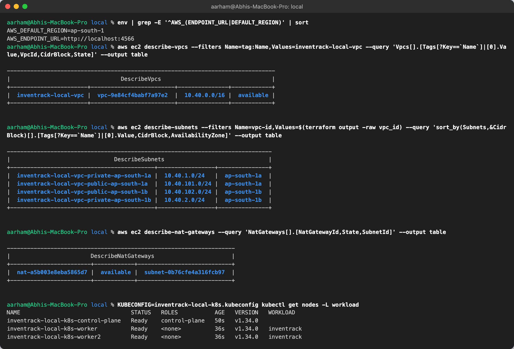
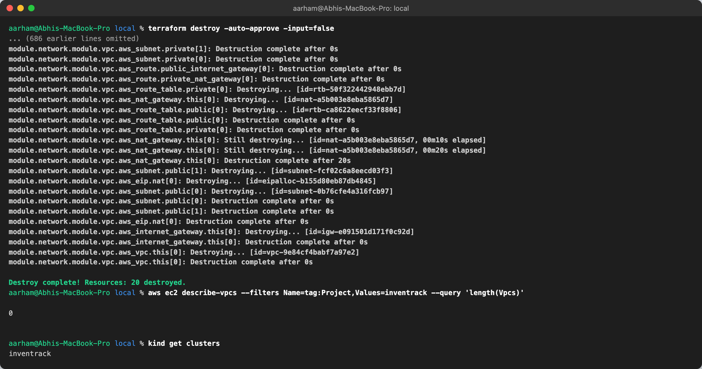

## 11. Kubernetes and Helm (M8)

```bash
kind create cluster --config kubernetes/kind/cluster.yaml
kubectl apply -f k8s/namespace.yaml
helm upgrade --install inventrack helm/inventrack -n inventrack -f helm/inventrack/values-local.yaml --wait
```

The chart deploys the API (2 replicas, HPA up to 5), web (2 replicas), PostgreSQL as a StatefulSet with a 1 Gi PVC, three **ClusterIP** Services, an **Ingress** (`/api` → API, `/` → web, host `inventrack.local`), a PDB, a ConfigMap, a generated Secret, the Alembic hook Job and an optional ServiceMonitor. Every pod runs non-root with dropped capabilities, under the namespace's **restricted** Pod Security Standard. `helm lint` passes. Install, upgrade and rollback were all used in the troubleshooting challenge. Details: [kubernetes/README.md](kubernetes/README.md).

The release was first installed with `helm upgrade --install` (the troubleshooting screenshots show its upgrades, history and rollbacks), then handed over to Argo CD. This screenshot was taken during a load test, with the HPA already at 4 API pods:

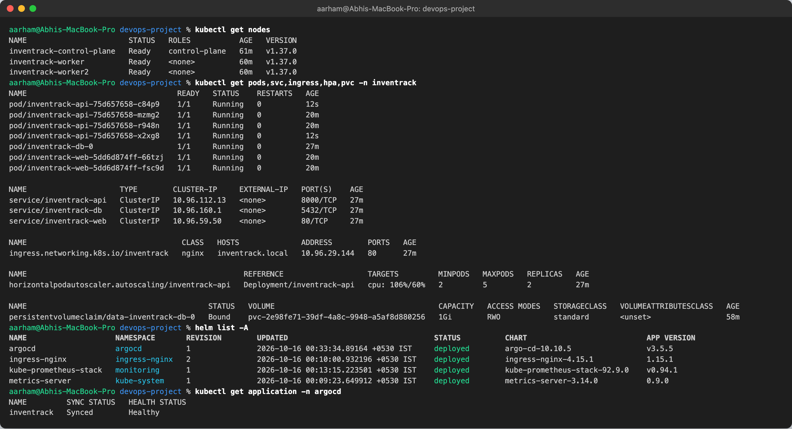
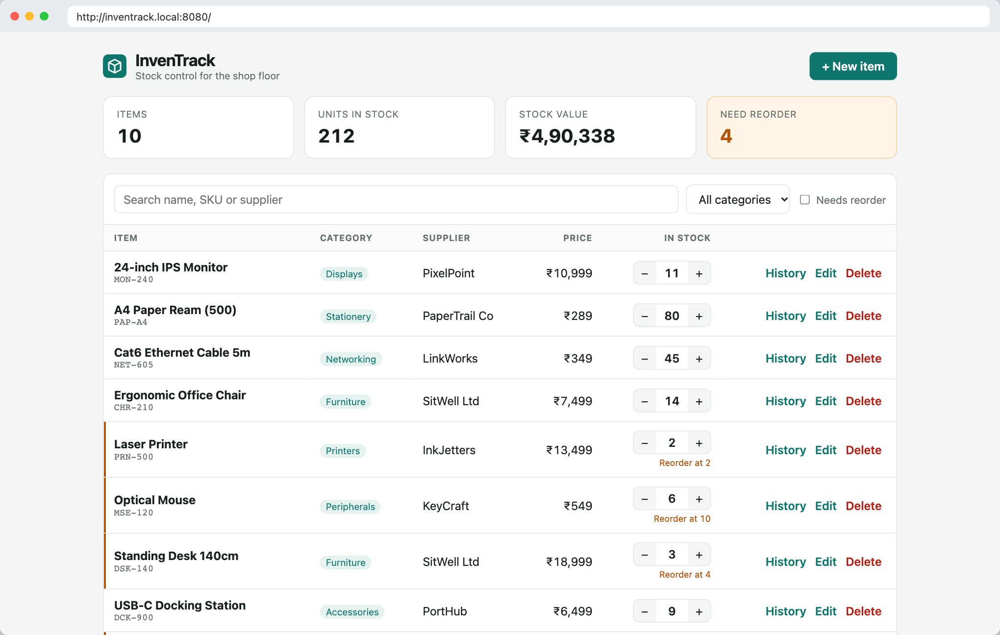
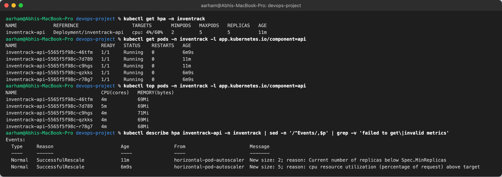

## 12. Observability (M9)

The API exposes `http_requests_total`, `http_request_duration_seconds` and `http_requests_inprogress` at `/metrics`, and a test checks the format. kube-prometheus-stack scrapes every API pod through the chart's ServiceMonitor. A 15-panel Grafana dashboard (imported automatically from a ConfigMap) shows traffic, error share, latency percentiles, CPU, memory and HPA replicas. Six alert rules cover availability, crash loops, 5xx rate, latency and HPA saturation. Details: [monitoring/README.md](monitoring/README.md).

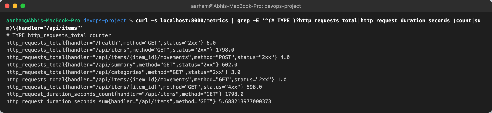
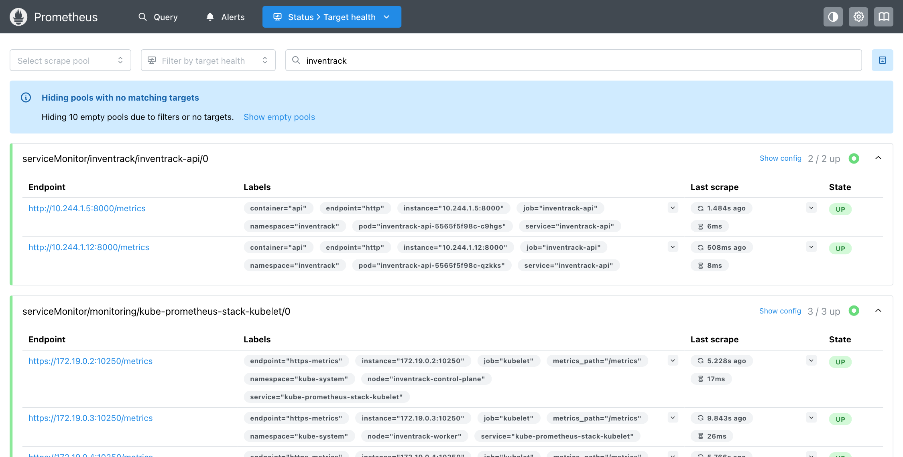
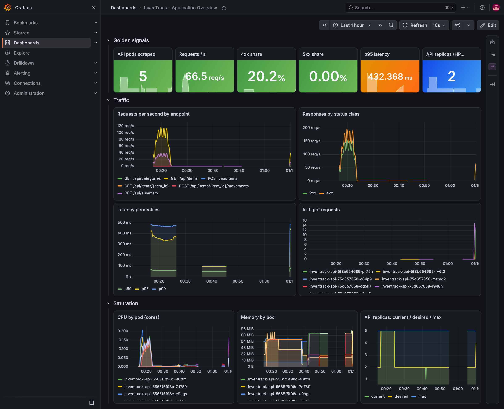
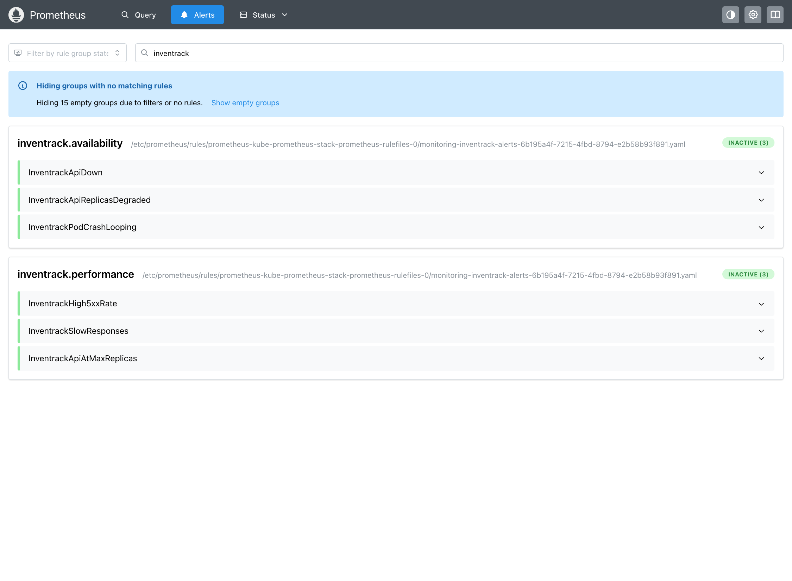

## 13. GitOps

Argo CD watches `helm/inventrack` on `main` with `values-gitops.yaml`, which the pipeline writes. It auto-syncs, prunes and self-heals. To roll back, `git revert` the bump commit. Details and setup: [gitops/README.md](gitops/README.md).

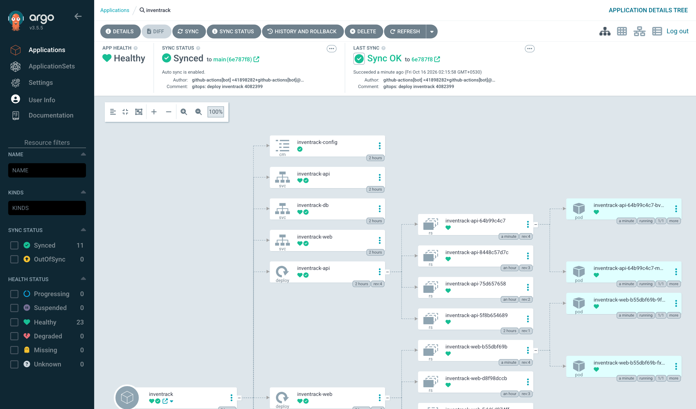

## 14. Troubleshooting

I broke the running cluster four ways and fixed each one: an image tag that doesn't exist, a Service selector typo, a wrong DB password, and a memory limit low enough to get OOMKilled. Each is written up with symptoms, investigation, root cause, fix, prevention and real output in [troubleshooting/README.md](troubleshooting/README.md). The selector case also turned up a Helm 4 server-side-apply field-ownership conflict, fixed with `--force-conflicts`.

## 15. Live demo (M10)

1. Open the app (Ingress or port-forward) and add an item.
2. Change something visible, such as the footer in `application/frontend/src/App.jsx`, then commit and push:
   ```bash
   git commit -am "Change footer for the live demo" && git push
   ```
3. GitHub Actions: tests → security checks → Trivy → push to GHCR → kind deploy test → `gitops: deploy inventrack <sha>` commit.
4. GHCR: the new `:<sha>` tags.
5. Argo CD: `inventrack` goes OutOfSync → Synced on the new SHA.
6. `kubectl get pods -n inventrack -w` shows the rolling update. Then:
   ```bash
   kubectl get deploy inventrack-web -n inventrack -o jsonpath='{.spec.template.spec.containers[0].image}'
   ```
7. Reload the app and the change is live. Grafana shows the demo traffic.

I ran this exact flow for v1.1. See [gitops/README.md](gitops/README.md#live-run-v11).

---

## 16. Rubric checklist

| Module | Criterion | Evidence | |
|---|---|---|---|
| **M1** | FastAPI `/health` | `app/main.py`, `test_health_is_ok` | ✅ |
| | 4+ REST endpoints (GET/POST/PUT/DELETE) | 8 inventory endpoints, §4 | ✅ |
| | PostgreSQL tables from Alembic | `alembic/versions/20261015_01_items.py`, `…_02_stock_movements.py` | ✅ |
| | Frontend renders and calls the API | `src/api.js`, `app-desktop.png` | ✅ |
| | Responsive UI | `app-mobile.png` | ✅ |
| **M2** | pytest passes | `pytest-results.png`: 23 passed | ✅ |
| | 5+ tests over 3+ endpoints | 23 tests, every endpoint | ✅ |
| | Separate test DB | SQLite in `tests/conftest.py` | ✅ |
| | `pytest.ini` / `conftest.py` | present | ✅ |
| **M3** | Public repo | link above | ✅ |
| | 10+ meaningful commits | `git-commit-history.png` | ✅ |
| | `.gitignore` | root + per-folder | ✅ |
| **M4** | Backend Dockerfile builds | `application/backend/Dockerfile` | ✅ |
| | Multi-stage frontend (Node + nginx) | `application/frontend/Dockerfile` | ✅ |
| | Non-root | uid 10001 / 101, `docker-compose-up.png` | ✅ |
| | `docker compose up --build` with 3 services | `docker-compose-up.png` | ✅ |
| **M5** | Workflow file, push to `main` trigger | `.github/workflows/ci-cd.yml` | ✅ |
| | pytest gates the build | `backend-tests` | ✅ |
| | Frontend built, both images built | `frontend-build`, `build-images` | ✅ |
| | Pushed to GHCR with SHA tags, no `latest` | `publish`, `ghcr-backend-sha-tag.png` | ✅ |
| **M6** | Trivy on both images, fails on HIGH/CRITICAL | `scan-images` | ✅ |
| | CVE explained | §9, `security/README.md` | ✅ |
| **M7** | Valid HCL, `init` | `terraform-validate.png` | ✅ |
| | Non-empty `plan` | `terraform-plan-aws-eks.png` (57), `terraform-plan-local.png` (20) | ✅ |
| | VPC with 2+ public subnets | `modules/network`, `terraform-vpc-cluster.png` | ✅ |
| | EKS + worker node group | `main.tf` `module "eks"`, planned. kind stand-in applied (§10) | ✅ (planned, no paid apply) |
| | `destroy` cleans up | `terraform-destroy.png` | ✅ |
| | `tfvars.example`, no credentials | present, `terraform.tfvars` gitignored | ✅ |
| **M8** | `k8s/namespace.yaml` | present | ✅ |
| | Chart with `Chart.yaml`, `values.yaml`, templates | `helm/inventrack/` | ✅ |
| | `helm upgrade --install` works | `troubleshooting/` screenshots (upgrade, history, rollback). Argo CD now owns the release (`k8s-resources.png`) | ✅ |
| | 2+ replicas each, ClusterIP Services | `k8s-resources.png` | ✅ |
| | Ingress `/` and `/api` | `templates/ingress.yaml`, `k8s-app-ingress.png` | ✅ |
| | All pods Running | `k8s-resources.png` | ✅ |
| **M9** | `/metrics` in Prometheus format | `metrics-endpoint.png`, test | ✅ |
| | Prometheus scraping | `prometheus-targets.png` | ✅ |
| | Grafana with a live app panel | `grafana-dashboard.png` | ✅ |
| **M10** | README explains the project | this file | ✅ |
| | Live demo | §15, done for v1.1 | ✅ |

## 17. What I learned

- **Readiness probes and `maxUnavailable: 0` are what keep users safe.** In three of the four troubleshooting cases the broken version never got traffic, and the API kept returning 200.
- **Base images carry CVEs too.** All 43 HIGH findings came from the nginx Alpine base, not my code, and `apk upgrade` fixed them all.
- **Scan what you ship.** Images are built once, scanned as a tarball and pushed from that same tarball. Rebuilding after the scan would make the scan worthless.
- **Migrations belong in one place.** Running Alembic in every replica races. A hook Job runs it exactly once per release.
- **Helm 4 uses server-side apply.** A hand `kubectl patch` takes ownership of a field, and Helm refuses to overwrite it until told to (`--force-conflicts`). That's one more reason not to edit live objects.
- **Size resources from data.** The API needs ~64 Mi. A 40 Mi limit means OOMKilled (exit 137), and `kubectl top` or the Grafana memory panel would have shown that before release.
- **You can practise cloud infrastructure without a bill.** LocalStack plus kind let me plan the real EKS config and run a full apply/destroy cycle of the shared network module for free. I'm clear in the docs about what is emulated.

## License

MIT, see [LICENSE](LICENSE).
