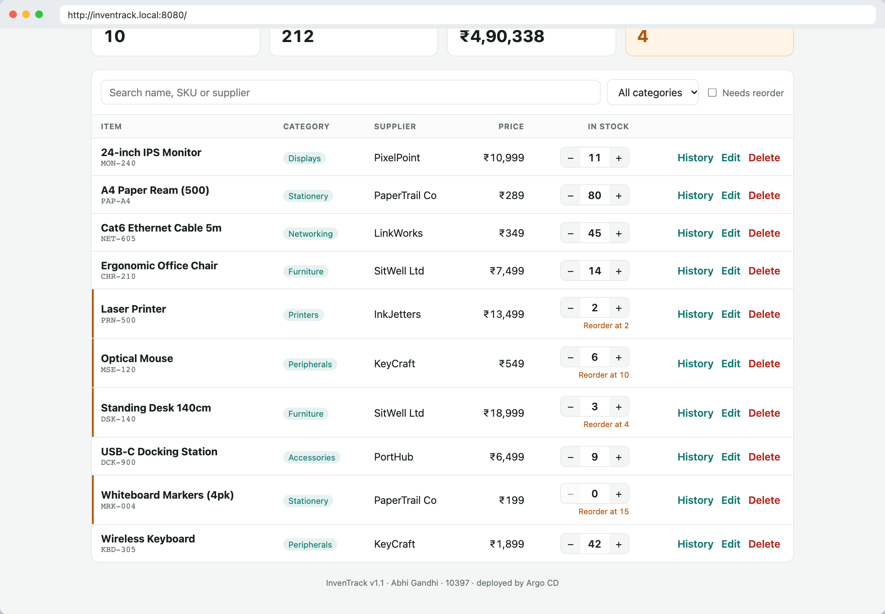

# GitOps with Argo CD

Git is the source of truth for what runs in the cluster. Nothing is applied by hand: CI writes a new image tag into Git, and Argo CD makes the cluster match.

```
push to main ─► CI: test, scan, build, push ghcr.io/…:<sha> ─► gitops-bump job commits <sha> to
helm/inventrack/values-gitops.yaml ─► Argo CD sees the commit ─► helm render ─► rolling update
```

## Setup (once)

```bash
helm repo add argo https://argoproj.github.io/argo-helm
helm upgrade --install argocd argo/argo-cd -n argocd --create-namespace \
  --set configs.params."server\.insecure"=true --set dex.enabled=false

kubectl apply -f k8s/namespace.yaml
# Argo CD renders Helm without cluster access, so the chart can't generate and remember a DB password.
# Create the Secret once (or keep the one a previous `helm install` left behind - it has resource-policy: keep):
kubectl create secret generic inventrack-db -n inventrack --from-literal=password="$(openssl rand -hex 16)"

kubectl apply -f gitops/argocd-application.yaml
kubectl port-forward -n argocd svc/argocd-server 8090:80
kubectl get secret -n argocd argocd-initial-admin-secret -o jsonpath='{.data.password}' | base64 -d
```

The GHCR packages inherit the repository's **public** visibility, so the cluster pulls them without an image pull secret.

## Application settings (`argocd-application.yaml`)

- **source:** this repo, `main`, `helm/inventrack` with `values.yaml` + `values-gitops.yaml`
- **automated sync** with `prune: true` (objects deleted from Git are deleted from the cluster) and `selfHeal: true` (manual edits are reverted)
- **retry** with backoff, so a sync that starts while PostgreSQL is still booting tries again
- the chart's migration Job is a Helm hook, and Argo CD runs it as a **PostSync** hook

**Rollback** is a `git revert` of the bump commit. Argo CD then deploys the previous SHA.

## Live run

Commit `4082399` was pushed to `main`. CI run [#38803735072](https://github.com/AbhiGandhi02/inventrack-devops/actions/runs/38803735072) tested, scanned, built and pushed `ghcr.io/abhigandhi02/inventrack-devops/inventrack-{backend,frontend}:4082399…`. Its `gitops-bump` job committed `6e787f8 gitops: deploy inventrack 4082399`. Argo CD picked up that commit and rolled both Deployments onto the new images, with no manual `kubectl` or `helm` step:


The release that changed the footer to v1.1 went through the same flow. The app as served through the Ingress afterwards:


