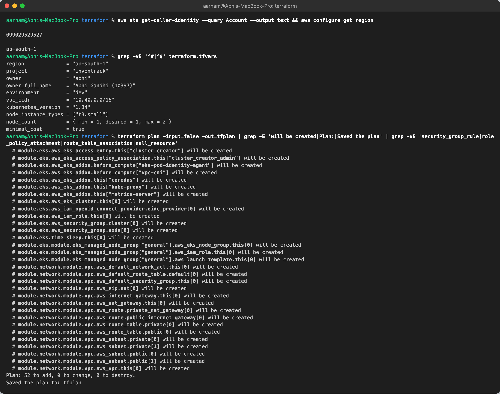
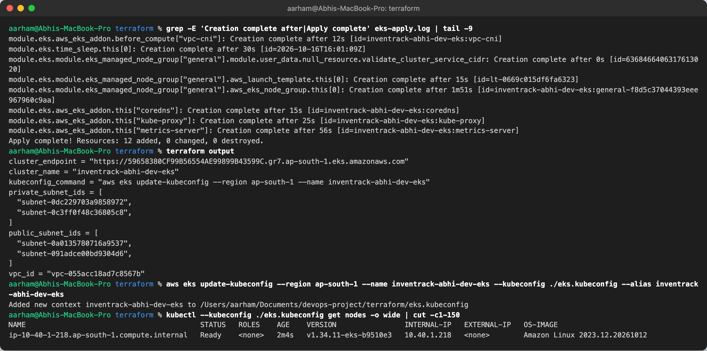
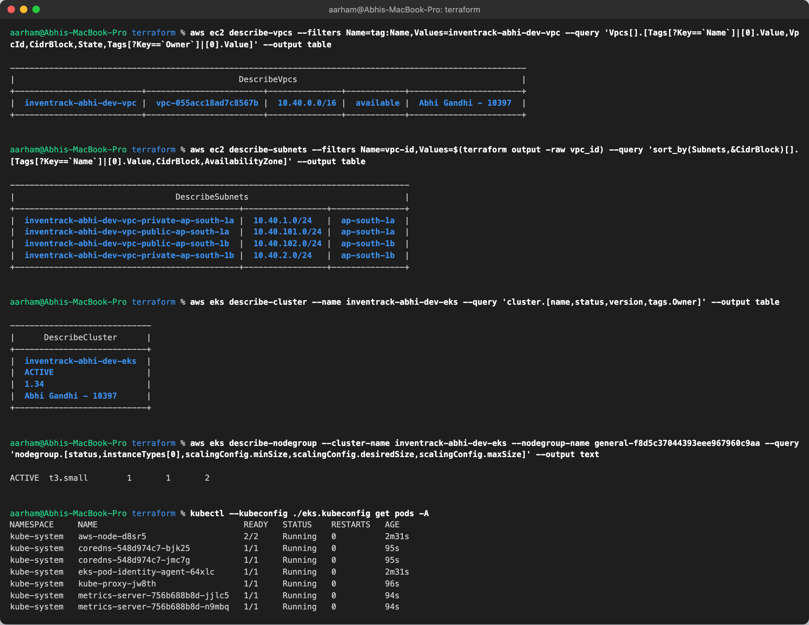
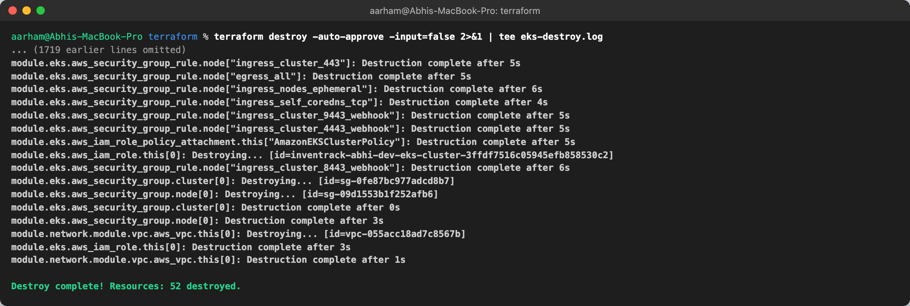
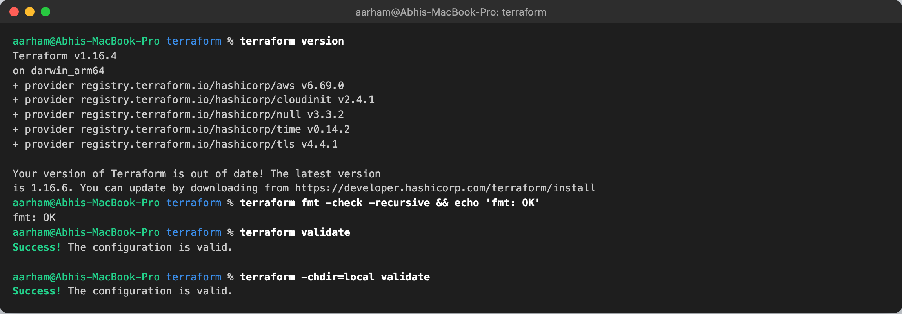
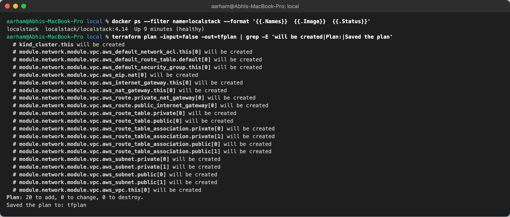

# Terraform

```
terraform/
├── modules/network/      # shared: VPC, 2 public + 2 private subnets, IGW, 1 NAT gateway, EKS subnet tags
├── main.tf …             # AWS root: network module + EKS cluster + managed node group (ap-south-1)
├── localstack_override.tf.example   # copy to *_override.tf to plan the AWS root against LocalStack
└── local/                # no-cloud root: same network module on LocalStack + a kind cluster in place of EKS
```

## AWS (`terraform/`)

- **VPC** `10.40.0.0/16` across 2 AZs. Public subnets `10.40.101.0/24` and `10.40.102.0/24`, private subnets `10.40.1.0/24` and `10.40.2.0/24`. One NAT gateway (cheaper; production would use one per AZ).
- **EKS** `inventrack-abhi-dev-eks` (Kubernetes 1.34) with control-plane logs and KMS secrets encryption (both switched off by `minimal_cost = true`) and add-ons (`vpc-cni`, `coredns`, `kube-proxy`, `eks-pod-identity-agent`, `metrics-server`).
- **Managed node group** `general`: `t3.medium`, min 2 / desired 2 / max 4 by default (the real run used 1× `t3.small`, see below), in the **private** subnets.
- Credentials come only from `aws configure` or the environment. `terraform.tfvars` is gitignored, and only `terraform.tfvars.example` is committed.

```bash
cd terraform
cp terraform.tfvars.example terraform.tfvars
terraform init && terraform plan && terraform apply
aws eks update-kubeconfig --region ap-south-1 --name inventrack-abhi-dev-eks
terraform destroy      # EKS and the NAT gateway bill by the hour
```

## Real AWS run (smallest possible)

I applied the **unchanged** `terraform/` config to a real AWS account in `ap-south-1`, keeping cost to a minimum. The account is borrowed and its IAM user is `tirth-alt`, but every resource is named and tagged for me: `inventrack-abhi-dev-*`, `Owner = Abhi Gandhi - 10397`. I deleted everything right after taking the screenshots.

| Setting (`terraform.tfvars`, gitignored) | Value | Why |
|---|---|---|
| `node_instance_types` | `["t3.small"]` | smallest size that still fits the EKS system pods |
| `node_count` | `{ min = 1, desired = 1, max = 2 }` | one worker node |
| `minimal_cost` | `true` | no KMS key and no control-plane log group (both bill or linger after destroy) |
| NAT gateways | 1 | `single_nat_gateway = true` |

The run cost roughly $0.20/hour (EKS control plane, one t3.small, one NAT gateway and its IP) for well under an hour.

What happened, unedited:
1. `terraform plan`: 52 to add.
2. First `apply`: the VPC, subnets, IGW, NAT and security groups were created, then **both IAM roles were rejected** because IAM tag values may not contain `(` `)` (my Owner tag was `Abhi Gandhi (10397)`). I changed it to `Abhi Gandhi - 10397` and added a `validation` block to `owner_full_name` so this can't happen again.
3. Second `apply`: the IAM roles were created and the EKS cluster creation started, but the local machine lost DNS while waiting (`lookup eks.ap-south-1.amazonaws.com: no such host`), so Terraform marked the cluster **tainted**. AWS kept building it. I waited with `aws eks wait cluster-active` and ran `terraform untaint` so the healthy cluster was **not** destroyed and rebuilt.
4. Third `apply`: 12 added (add-ons, node group, access entry). The node group was ACTIVE after 1m51s.
5. `kubectl get nodes`: 1 node `Ready`, v1.34.11-eks, in private subnet 10.40.1.0/24. All system pods Running.
6. `terraform destroy`: everything removed (see below).









## Practising without an AWS account (LocalStack + kind)

Before the real run I built and tested everything for free. This is still useful for anyone without AWS access:

1. **Static checks, no credentials:** `terraform fmt -check`, `init` and `validate` pass for both roots. CI runs them on every push.
2. **Plan the real AWS config offline:** [LocalStack](https://localstack.cloud) 4.14 (community) emulates the AWS APIs in Docker. With `localstack_override.tf` in place, `terraform plan` of the **unchanged** VPC + EKS root resolves every data source and plans **57 resources**, including the EKS cluster, node group, IAM roles, KMS key and security groups.
3. **Real apply/destroy cycle (`terraform/local/`):** the **same `modules/network`** is applied to LocalStack's EC2 API: VPC, 4 subnets, IGW, NAT, EIP and route tables. A `kind_cluster` with 1 control plane + 2 workers stands in for EKS, because EKS isn't in the free LocalStack edition. `terraform apply` creates 20 resources. The VPC and subnets can then be queried with `aws ec2 describe-*` against LocalStack, and `kubectl get nodes` shows the 3 nodes Ready. `terraform destroy` removes everything.

```bash
docker run -d --name localstack -p 4566:4566 localstack/localstack:4.14
cd terraform/local && terraform init && terraform plan -out=tfplan && terraform apply tfplan
export KUBECONFIG=$PWD/inventrack-local-k8s.kubeconfig && kubectl get nodes
terraform destroy
```

LocalStack only emulates the API: the IDs are real LocalStack IDs, but no AWS hardware or network exists. That's why the real AWS run above exists too.

## Evidence

`fmt`, `validate` (both roots):



`terraform plan` of the **AWS VPC + EKS** root against LocalStack, 57 to add:


`terraform plan` of the local root, 20 to add:



`terraform apply`, 20 added, with the cluster outputs:


VPC, 2 public + 2 private subnets and the NAT gateway as the AWS CLI sees them, and the 3 kind nodes Ready:


`terraform destroy`, 20 destroyed, no VPC left:


