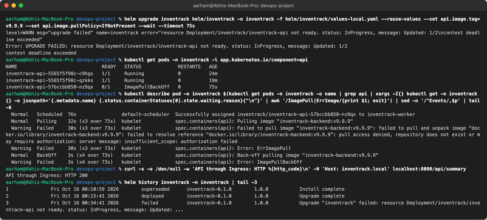
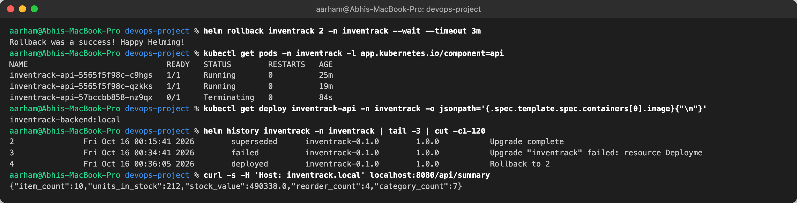
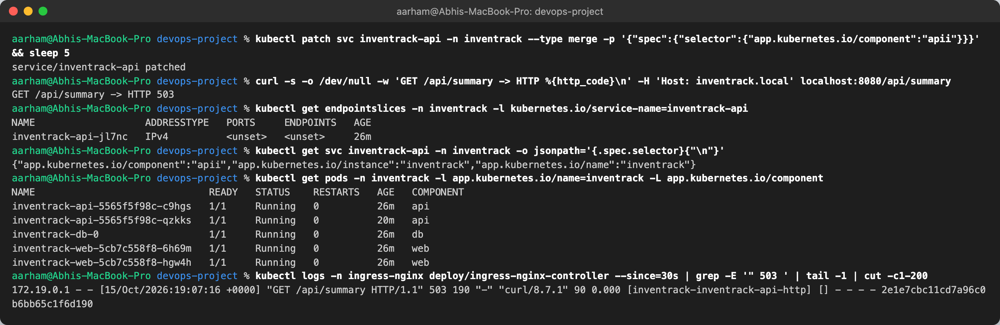
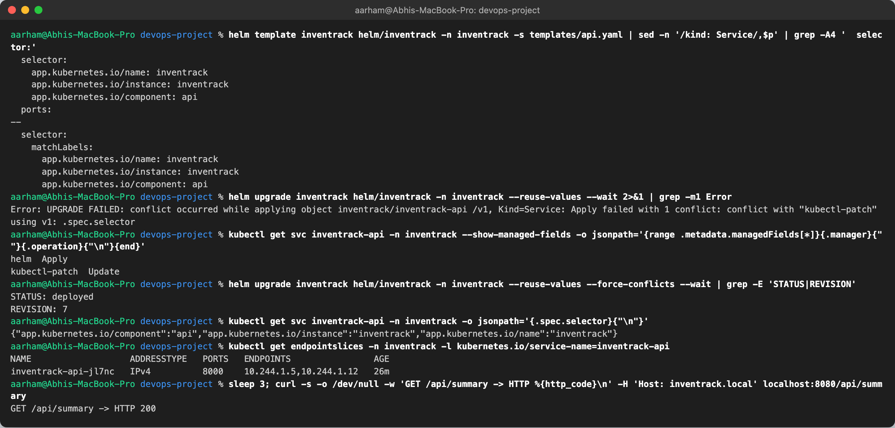
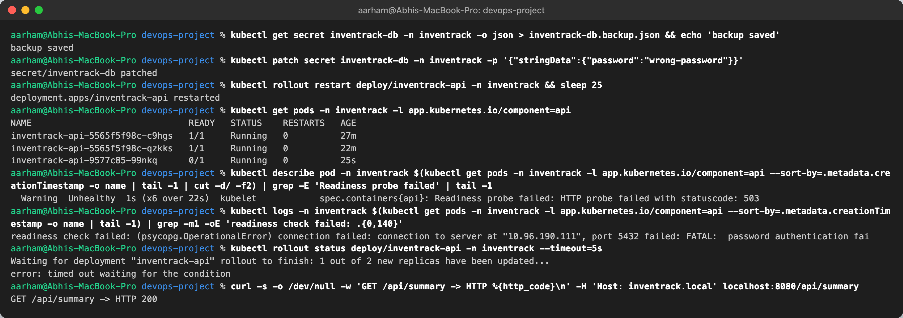
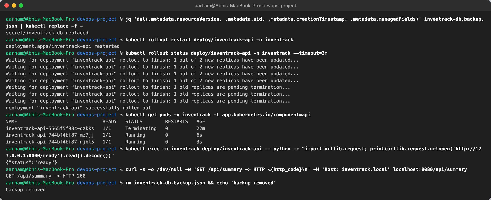
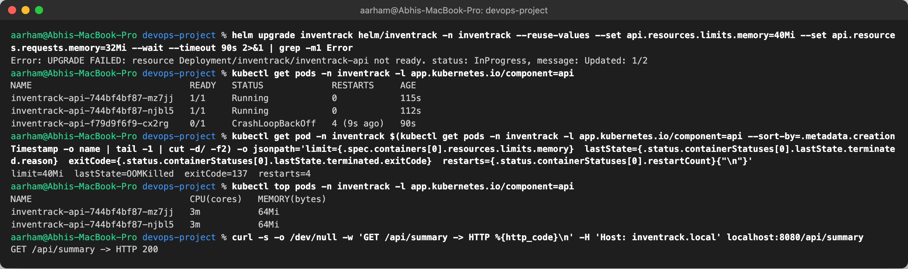
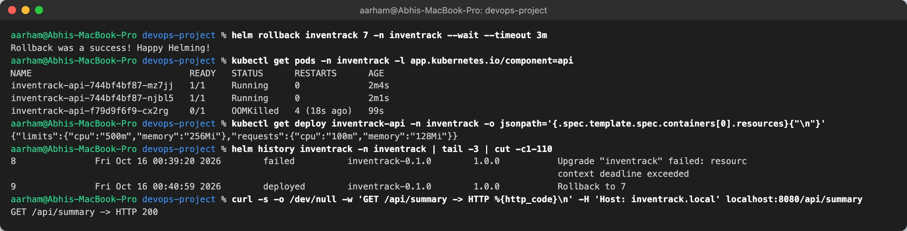

# Troubleshooting Challenge

**Name:** Abhi Gandhi · **Roll Number:** 10397

I broke the running InvenTrack deployment on the local kind cluster in four different ways. For each one I found the cause with ordinary `kubectl`/`helm` commands, fixed it, and checked the fix. Every screenshot below shows real commands and real output from that cluster.

| # | What I broke | What users / operators saw | Root cause | Fix |
|---|---|---|---|---|
| 1 | Released an image tag that was never built | New pod `ImagePullBackOff`, release `failed` | `api.image.tag=v9.9.9` does not exist | `helm rollback` |
| 2 | Typo in the API Service selector | Ingress returns **HTTP 503** | Selector `component=apii` matches no pods, so there are no endpoints | Re-apply the chart (`--force-conflicts`) |
| 3 | Wrong DB password in the Secret | New pod `Running` but `0/1` Ready, rollout stuck | API cannot log in to PostgreSQL, `/ready` returns 503 | Restore the Secret, restart the rollout |
| 4 | Memory limit set below what the app needs | New pod `CrashLoopBackOff` | Container `OOMKilled` (exit 137) at a 40 Mi limit | `helm rollback` |

**What all four show:** users only noticed scenario 2. In scenarios 1, 3 and 4 the old pods kept serving, so the API kept returning **HTTP 200** while the new version was broken. That works because the API Deployment uses `maxUnavailable: 0` (an old pod is never removed before its replacement is Ready) and has a real readiness probe (`/ready` checks the database). Scenario 2 broke routing, not pods, so the rolling update couldn't protect against it.

---

## 1. Bad image tag → ImagePullBackOff

**Break it:** `helm upgrade … --set api.image.tag=v9.9.9 --wait --timeout 75s`

**Investigate:**
- `helm upgrade` fails with `Deployment … not ready … Updated: 1/2`.
- `kubectl get pods`: the new pod is `ImagePullBackOff`, and the two old pods are still `1/1 Running`.
- `kubectl describe pod` → Events: `Failed to pull image "inventrack-backend:v9.9.9" … repository does not exist`.
- `helm history`: revision 3 is `failed`.
- The API through the Ingress still returns **200**.



**Root cause:** the tag was never built or pushed. The kubelet tried Docker Hub's `library/inventrack-backend` and was refused.

**Fix:** `helm rollback inventrack 2 --wait`. The broken pod goes away, the Deployment is back on `inventrack-backend:local`, and the release history records `Rollback to 2`.



**Prevention:** CI only deploys tags it has just built, scanned and pushed (commit SHAs), and the GitOps values file is written by the pipeline, not by hand.

---

## 2. Service selector typo → HTTP 503

**Break it:** `kubectl patch svc inventrack-api … selector component=apii`

**Investigate:**
- `curl` through the Ingress → **HTTP 503**. ingress-nginx has no upstream for `/api`.
- `kubectl get endpointslices -l kubernetes.io/service-name=inventrack-api` → `ENDPOINTS <unset>`.
- The Service selector says `component: apii`, while `kubectl get pods -L app.kubernetes.io/component` shows the pods labelled `api`.



**Root cause:** a Service only routes to pods whose labels match its selector. A one-letter typo matched nothing, even though all pods were healthy.

**Fix, and a Helm 4 lesson:** the first `helm upgrade --reuse-values` was **refused**: `conflict with "kubectl-patch" using v1: .spec.selector`. Helm 4 uses server-side apply, and `managedFields` showed that `kubectl-patch` now owned `.spec.selector`. Helm won't overwrite a field another manager owns unless you tell it to. `helm upgrade --force-conflicts` took ownership back, and the endpoints and HTTP 200 returned.



**Prevention:** never hand-edit live objects. Under Argo CD (`selfHeal: true`) this drift would have been reverted automatically within seconds.

---

## 3. Wrong database password → stuck rollout

**Break it:** back up the Secret, then `kubectl patch secret inventrack-db … password=wrong-password` and `kubectl rollout restart deploy/inventrack-api`.

**Investigate:**
- `kubectl get pods`: the new pod is `Running` but `0/1` Ready. The old pods are still `1/1`.
- `kubectl describe pod`: `Readiness probe failed: HTTP probe failed with statuscode: 503`.
- `kubectl logs`: `readiness check failed: (psycopg.OperationalError) … password authentication failed`.
- `kubectl rollout status` → timed out at `1 out of 2 new replicas have been updated`.
- Users still get **200** from the old pods, which were started with the correct password.



**Root cause:** the API reads `DB_PASSWORD` from the Secret when the container starts. New pods got the wrong value and could not authenticate to PostgreSQL, whose password had not changed.

**Fix:** restore the Secret from the backup (stripping `resourceVersion`/`uid` so `kubectl replace` accepts it), then `rollout restart`. The rollout completes, `/ready` returns `{"status":"ready"}`, and I deleted the backup file. It is also gitignored.



**Prevention:** treat DB credentials as one unit. Rotate the password in PostgreSQL and in the Secret together, ideally through an external secret manager. The `helm.sh/resource-policy: keep` annotation stops `helm uninstall` from deleting the Secret.

---

## 4. Memory limit too low → OOMKilled

**Break it:** `helm upgrade … --set api.resources.limits.memory=40Mi --set api.resources.requests.memory=32Mi`

**Investigate:**
- `helm upgrade` fails (`not ready … Updated: 1/2`).
- The new pod is in `CrashLoopBackOff`, with 4 restarts in 90 s.
- Pod status shows `limit=40Mi lastState=OOMKilled exitCode=137`. Exit code 137 means the process got SIGKILL from the kernel's OOM killer.
- `kubectl top` shows the healthy API pods actually use **~64 Mi**.
- Users still get **200**.



**Root cause:** Python, FastAPI, SQLAlchemy and the metrics client together need about 64 Mi at startup. A 40 Mi cgroup limit kills the process before it can serve.

**Fix:** `helm rollback inventrack 7`. Limits are back to 128Mi request / 256Mi limit and the API answers 200. In the screenshot the crashed pod is still listed while the ReplicaSet scales it down.



**Prevention:** size limits from observed usage (`kubectl top`, or the *Memory by pod* panel in Grafana) plus headroom. The `InventrackPodCrashLooping` alert fires when a pod restarts more than twice in 10 minutes.

---

## Commands I used most

```bash
kubectl get pods -n inventrack -o wide
kubectl describe pod <pod> -n inventrack        # Events: pull errors, probe failures, OOM
kubectl logs <pod> -n inventrack [--previous]   # app errors, logs of the crashed container
kubectl get endpointslices -n inventrack        # does the Service have backends?
kubectl rollout status deploy/inventrack-api -n inventrack
kubectl top pods -n inventrack                  # real CPU / memory
helm history inventrack -n inventrack
helm rollback inventrack <revision> -n inventrack --wait
```
